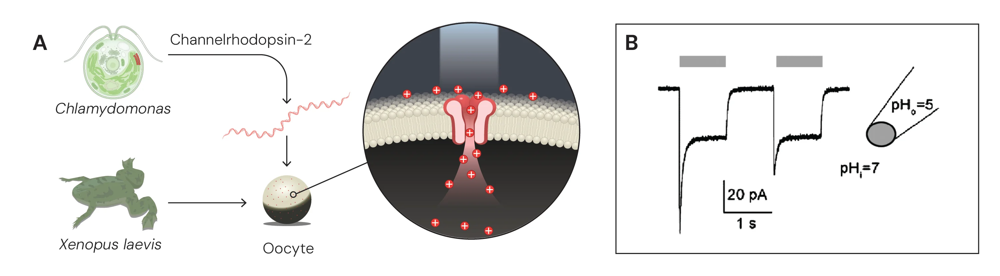
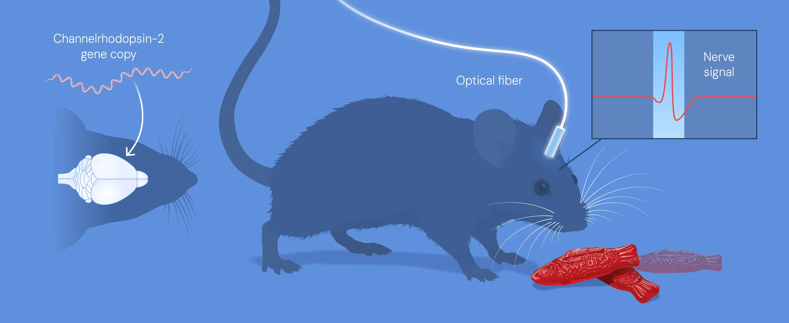

# The Brain's Light Switch: How an Algae Protein Won the 2026 Nobel Prize in Medicine

Imagine being able to turn specific brain cells on or off with the flick of a switch. It sounds like science fiction, but it is exactly what earned Karl Deisseroth, Peter Hegemann, and Georg Nagel the 2026 Nobel Prize in Physiology or Medicine.

While the Nobel announcement brings fresh global attention to the field, the foundational discoveries began over two decades ago. The trio pioneered a revolutionary technique called optogenetics. By borrowing a survival mechanism from a microscopic pond organism, they provided neuroscientists with an unprecedented tool —the ability to control individual neurons using targeted flashes of light.

## From Pond Scum to Neuroscience

To understand optogenetics, we have to look at single-celled green algae. These organisms need sunlight to survive, and they move toward it using light-sensitive proteins called channelrhodopsins. When light hits these proteins, they act as biological gates, opening up to let electrically charged ions rush into the cell.

<em>Heterologous expression of channelrhodopsin-2 in Xenopus laevis oocytes. (Credit: The Nobel Committee for Physiology or Medicine. Ill. Mattias Karlén)</em>

In 2002, 24 years ago, <a href="https://doi.org/10.1126/science.1072068">Hegemann and Nagel</a> mapped how these algal proteins (channelrhodopsin) functioned. By 2005, <a href="https://doi.org/10.1038/nn1525">Deisseroth’s</a> laboratory achieved a critical breakthrough: successfully engineering these proteins into mammalian brain cells. By inserting the genetic code for these light-sensitive gates into specific neurons, scientists created brain cells that could be instantly activated by shining a light on them.

<em>Deisseroth successfully activated nerve cells in the brains of living mice. (Credit: The Nobel Committee for Physiology or Medicine. Ill. Mattias Karlén)</em>

## Blue Means Go, Yellow Means Stop

Once these proteins are integrated, researchers use fiber-optic cables to deliver precise bursts of light directly into the brain. A flash of blue light opens the channelrhodopsin gates, causing the targeted neuron to fire.

While Hegemann and Nagel’s early Channelrhodopsins were purely excitatory (letting positive ions in), scientists later engineered and discovered different light-sensitive proteins specifically designed to shut down neurons on command:

- <strong><a href="https://www.sciencedirect.com/topics/neuroscience/halorhodopsin">Halorhodopsin (NpHR)</a></strong><strong>:</strong> A light-driven pump triggered by yellow light. It actively forces negative Chloride ions (Cl⁻) inside the cell, silencing the neuron instantly.

- <strong><a href="https://pmc.ncbi.nlm.nih.gov/articles/PMC4595828/">Anion Channelrhodopsins (ACRs):</a></strong> Discovered later in cryptophyte algae, these function as light-gated channels. When flashed with blue light, they pop open wide and allow a massive flood of negative Chloride ions to pass through.

- <strong><a href="https://pmc.ncbi.nlm.nih.gov/articles/PMC4595828/">Archaerhodopsin (Arch)</a></strong><strong>:</strong> Instead of bringing negative ions in, this protein reacts to yellow-green light by pumping positive protons (H⁺) out of the cell, achieving the same exact silencing effect.

<em>Optogenetic activation and inhibition. Excitatory opsins respond to blue light by letting positive ions in. Inhibitory opsins respond to yellow light by actively pumping negative ions into the neuron to prevent the neuron from firing. (Credit: Gemini AI-generated conceptual illustration)</em>

Traditional neuro-pharmacological drugs flood the entire brain, often leading to widespread side effects because they affect both targeted and non-targeted circuits. Optogenetics acts with spatial and temporal precision, drastically reducing off-target effects in laboratory models. However, it is crucial to recognize that optogenetics is currently, first and foremost, a research tool. The requirement for invasive fiber-optic implants and gene therapy delivery presents significant hurdles for treating deep-brain conditions in humans.

## Moving Toward Clinical Therapy

Despite these hurdles, this technology is slowly bridging the gap from animal models to human clinical trials, particularly in areas where light delivery is less invasive.

In a landmark 2021 study published in <em>Nature Medicine</em> (<a href="https://doi.org/10.1038/s41591-021-01351-4">Sahel et al., 2021</a>), they utilized optogenetic therapies in an attempt to restore vision in a patient with retinitis pigmentosa, a genetic blinding disease. By engineering surviving retinal cells to become sensitive to light, the patient partially regained the ability to detect, locate, and count objects, a first reported case of partial functional recovery in a neurodegenerative disease after optogenetic therapy. While a remarkable milestone, it is important to note the limitations: the treatment did not restore normal, full-color vision, and it required the patient to wear specialized light-stimulating goggles to translate visual information into appropriate light pulses for the engineered cells.

## Why It Matters

The most profound contribution of the 2026 Nobel Prize lies in how it challenges us to rethink neuroscience itself. For decades, scientists have studied the brain by observing its activity and identifying patterns associated with certain behaviors, memories, and neurological disorders. Yet, understanding what happens in the brain is not the same as knowing what causes it. Establishing that link has long been one of neuroscience’s greatest challenges.

Optogenetics has helped bridge that gap. By using light to activate or silence specific groups of neurons, researchers can investigate how individual neural circuits influence behavior and contribute to disease. In animal models, this approach has opened new avenues for studying complex conditions such as Parkinson’s disease, anxiety, and depression. Rather than simply watching the brain at work, scientists can begin to test what happens when particular circuits are switched on or off.

## What Does This Mean Beyond the Laboratory?

- <strong>For researchers</strong>, optogenetics moves neuroscience beyond observation, allowing scientists to test how specific neural circuits drive behavior, memory, and disease.

- <strong>For pharmacists</strong>, it highlights the need for more targeted treatments that minimize off-target effects, offering insights that could guide future neuropharmacological drug development.

- <strong>For doctors</strong>, it points toward more precise neurological interventions that target the circuits underlying symptoms rather than broadly suppressing brain activity.

- <strong>For patients</strong>, it offers cautious hope that deeper insights into neural pathways could eventually lead to better treatments for conditions like Parkinson’s disease, treatment-resistant depression, and inherited blindness.

- <strong>For ordinary people</strong>, it shows how curiosity about something as simple as light-sensitive proteins in microscopic organisms can lead to breakthroughs in understanding the human brain.

And perhaps that is the most remarkable lesson of all: <strong>we do not always know where curiosity will lead us.</strong> A discovery made in the microscopic world can eventually reshape how we understand the human mind. Science rarely advances in a straight line. Sometimes, the key to unlocking one of the most complex systems in nature lies in understanding something seemingly simple—and having the curiosity to ask what else it might teach us.

## References & Further Reading:

- <a href="https://med.stanford.edu/news/all-news/2026/10/deisseroth-nobel-prize.html">Stanford Medicine: Deisseroth wins Nobel Prize for optogenetics</a>

- <a href="https://www.nobelprize.org/prizes/medicine/2026/press-release/">The Nobel Prize in Physiology or Medicine 2026</a>

- Boyden, E. S., Zhang, F., Bamberg, E., Nagel, G., &amp; Deisseroth, K. (2005). Millisecond-timescale, genetically targeted optical control of neural activity. <em>Nature Neuroscience</em>, 8(9), 1263–1268. <a href="https://doi.org/10.1038/nn1525">https://doi.org/10.1038/nn1525</a> 

- Nagel, G., Ollig, D., Fuhrmann, M., Kateriya, S., Musti, A. M., Bamberg, E., &amp; Hegemann, P. (2002). Channelrhodopsin-1: a Light-Gated proton channel in green algae. <em>Science</em>, 296(5577), 2395–2398. <a href="https://doi.org/10.1126/science.1072068">https://doi.org/10.1126/science.1072068</a> 

- Sahel, J., Boulanger-Scemama, E., Pagot, C., Arleo, A., Galluppi, F., Martel, J. N., Esposti, S. D., Delaux, A., De Saint Aubert, J., De Montleau, C., Gutman, E., Audo, I., Duebel, J., Picaud, S., Dalkara, D., Blouin, L., Taiel, M., &amp; Roska, B. (2021). Partial recovery of visual function in a blind patient after optogenetic therapy. <em>Nature Medicine</em>, 27(7), 1223–1229. <a href="https://doi.org/10.1038/s41591-021-01351-4">https://doi.org/10.1038/s41591-021-01351-4</a> 
